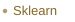

  <h1>Hi! I'm Lancelot 👋</h1>
  
<strong>MSc in Data Science</strong> Minor in Neural Information Processing

I'm curious about how the brain works—especially how it learns and processes information. That's what draws me to neuroscience, machine learning, and neurotechnology.

I'm looking for opportunities where I can bring data science and my interest in the brain together.

## 🛠️ Tools I work with

**Programming**

  <picture><source media="(prefers-color-scheme: dark)" srcset="./assets/tool-labels/python-dark.svg" /></picture>
  <picture><source media="(prefers-color-scheme: dark)" srcset="./assets/tool-labels/numpy-dark.svg" /></picture>
  <picture><source media="(prefers-color-scheme: dark)" srcset="./assets/tool-labels/pandas-dark.svg" /></picture>
  <picture><source media="(prefers-color-scheme: dark)" srcset="./assets/tool-labels/c-dark.svg" /></picture>
  <picture><source media="(prefers-color-scheme: dark)" srcset="./assets/tool-labels/java-dark.svg" /></picture>
  <picture><source media="(prefers-color-scheme: dark)" srcset="./assets/tool-labels/scala-dark.svg" /></picture>
  <picture><source media="(prefers-color-scheme: dark)" srcset="./assets/tool-labels/sql-dark.svg" /></picture>
  <picture><source media="(prefers-color-scheme: dark)" srcset="./assets/tool-labels/julia-dark.svg" /></picture>

**Machine Learning**

  <picture><source media="(prefers-color-scheme: dark)" srcset="./assets/tool-labels/pytorch-dark.svg" /></picture>
  <picture><source media="(prefers-color-scheme: dark)" srcset="./assets/tool-labels/sklearn-dark.svg" /></picture>
  <picture><source media="(prefers-color-scheme: dark)" srcset="./assets/tool-labels/pynest-dark.svg" /></picture>

## 🔬 Selected work

### 🧠 [Brain Explorer — Neuro Atlas](https://github.com/lacha25/brain-explorer)

An interactive 3D brain atlas connecting anatomy with region functions, learning mechanisms, and scientific references. Explore brain regions and follow conceptual learning journeys.

**JavaScript · Three.js** · [Explore the atlas](https://lacha25.github.io/brain-explorer/)

### 🍻 [PubCrawl — Crawl App](https://github.com/Crawl-App/app-frontend)

A mobile app for planning a pub crawl, with an interactive map and directions between stops. I contributed to the map and route interface.

**TypeScript · React Native · Expo**

### 🏔️ [Alpine Guard](https://github.com/eliemada/swiss-ai-hackathon-25)

A team prototype for exploring Swiss glaciers and estimating risk, built at Swiss AI Hackathon 2025. I contributed to the Python backend and machine learning risk-model pipeline.

**Python · FastAPI · scikit-learn**

### 🏃 [RunMap](https://github.com/lacha25/Running-Routes)

A transit planner that compares walking and running connections while respecting vehicle timetables. Includes an interactive map and a Google Maps companion extension.

**Python · JavaScript · Google Routes API**
